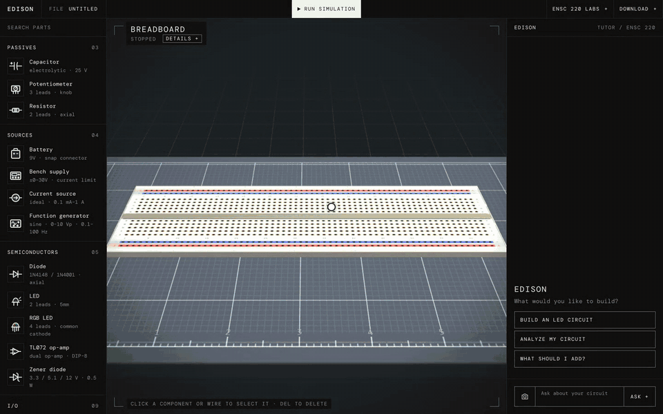
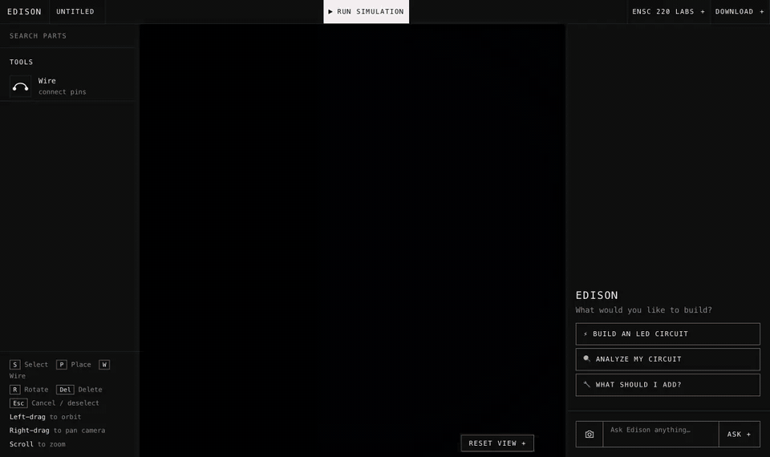
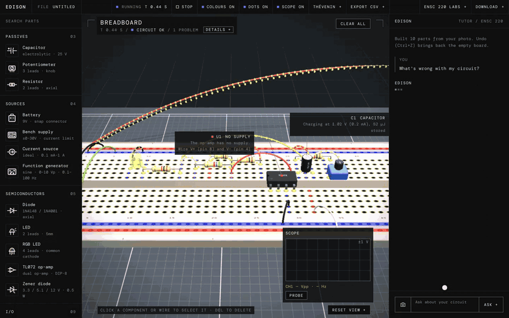
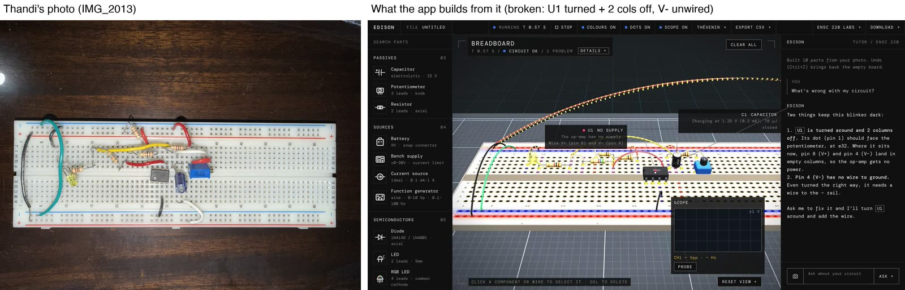
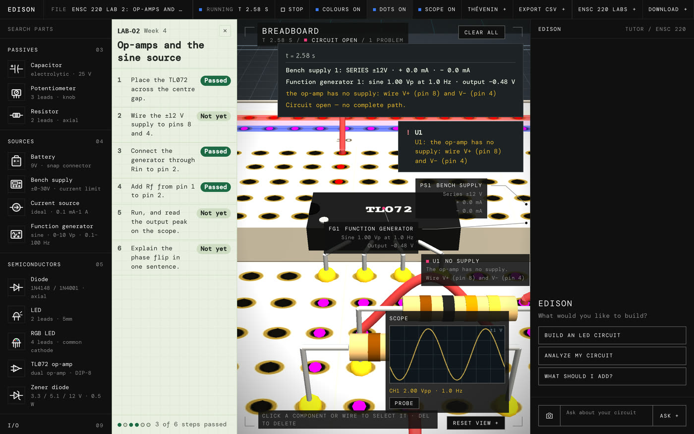
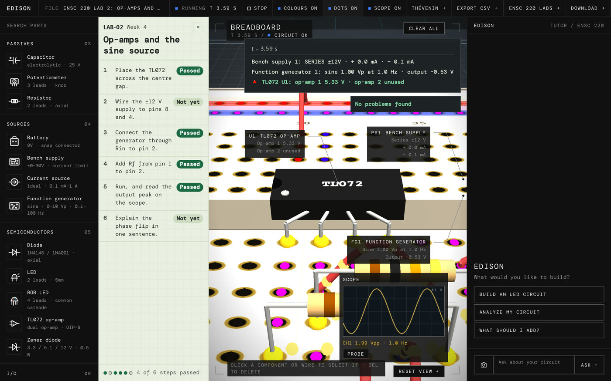
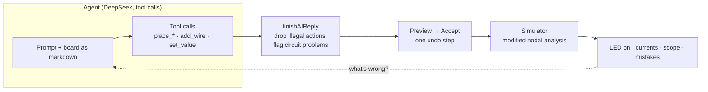
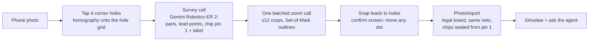

# Edison

**An AI agent that builds working circuits, and rebuilds a real breadboard from a photo.**

Describe a circuit in plain English, and Edison's agent places every part and wire on a 3D breadboard through tool calls. A circuit simulator written from scratch then checks that the build works. Or photograph a real breadboard: a vision pipeline reads every part and lead, rebuilds the board on screen, and the agent explains what's wrong with it.

### ▶ Try it live: **[edison-snowy.vercel.app](https://edison-snowy.vercel.app)**

The three demos on the welcome card run instantly with no sign-in. Sign in with Google to ask your own questions (5 a day).



---

## What it does

### 1. An agent that builds circuits

Ask for a circuit. The agent plans it, calls tools (`place_battery`, `place_resistor`, `place_led`, `place_tl072`, `add_wire`, …), and shows the build as a preview you accept in one click. Press Run and the simulator lights the LED.



### 2. It finds the mistakes on your real board, and fixes them

Edison simulates the board it rebuilt from your photo, so the agent can point at real problems: here, an op-amp turned around and two columns off, plus a missing V− wire. Say "fix it", accept the change, and the LED blinks.



| A student's real breadboard → what Edison builds from it |
|---|
|  |

### 3. A lab bench, not a toy

Bench supply, function generator, multimeter and scope; op-amps that clip at their rails; capacitors that charge over time. ENSC 220 labs come as step-by-step lab sheets that check each step against the simulation.

| Lab 2 with a mistake: the op-amp has no supply | Lab 2 running: a sine wave on the scope |
|---|---|
|  |  |

---

## How it works



- **The agent.** The board is sent as markdown (parts, holes, wires, simulation results), with a tool per part type drawn from the parts registry. Its reply is a list of actions. `finishAIReply` drops anything illegal (occupied holes, wrong spans, unknown pins) and flags circuit problems. The page shows a preview, and Accept applies it as one undo step.
- **The simulator.** Modified nodal analysis, the method SPICE uses, written from scratch and running in the browser: Gaussian elimination per step; time-stepped transients for capacitors and sine sources; diodes, LEDs and zeners with their knees; op-amps that clip 1.5 V inside their rails.
- **The eval.** `npm run ai-eval` sends 16 test prompts × 3 runs to the real model and grades each build **in the simulator** (does the LED light, does the op-amp output hit the expected voltage). The suite went from **24/48 to 35–38/48** as the prompts, tools and checks improved.
- **Prompt goldens.** Every prompt the agent sees is pinned in golden files, so a change to a part or a line of the prompt shows up as a reviewed diff, never a silent change.

### Photo → breadboard



- **Geometry first.** Four corner taps give a homography onto the exact hole grid, so the model is asked to *point*, not to count holes. Points snap to holes, and the model's own hole reading is only a tie-breaker.
- **Few calls.** A survey call returns every part with its lead points, plus each chip's pin-1 corner, notch and printed label. Then one batched call zooms on up to 12 parts at once, each crop outlined (Set-of-Mark). That's about **4 calls per photo instead of ~13**, with no requests lost to rate limits.
- **Chips are never guessed.** A DIP op-amp (TL072, LM358, NE5532, …) is seated from its pin-1 and pin-4 points. If the notch disagrees or the points are only box corners, Edison **asks** ("which end is pin 1? ⇄ to turn it") instead of building it backwards. A 555 or 741 is flagged, not built as a TL072. Op-amp boards get a ±12 V bench supply, as in the real lab.
- **Real handedness.** Edison's board has the same handedness as a real breadboard, so a chip's pins land on the holes printed on your board. Boards printed the other way are flipped on import, with a warning.

---

## Built with

| Layer | What |
|---|---|
| Frontend | Plain JavaScript and three.js (no framework, no build step): 3D breadboard, parts, wiring, HUD |
| Simulator | Modified nodal analysis, from scratch, in the browser |
| Agent | DeepSeek with tool calling (Gemini optional); a tool per part; validation before preview |
| Vision | Gemini Robotics-ER 2 (survey + batched zoom), homography in the browser |
| Backend | Node 20 with **zero runtime dependencies**: the AI routes, Google sign-in token checks (RS256 with `node:crypto`), daily limits |
| Hosting | Vercel (static app + one function), Firebase Google sign-in, Upstash Redis for daily counters |
| Tests | ~3,400 unit tests (Vitest) and ~360 browser tests (Playwright); no test ever calls a real AI |

**Public demo safety:** the three demos replay saved answers, so they cost nothing. Live questions need Google sign-in, and each user gets 5 a day. A global daily cap keeps the bill bounded.

## How it was built

Edison is built with an agentic workflow. Every change goes test-writer → builder → reviewer, as separate Claude Code agents. Hooks enforce their lanes: the test-writer can only touch tests, and the builder can't touch them. Each task's tests must fail first, and a change ships to `dev` only after lint, unit and browser tests pass. The details are in [docs/CONTRIBUTING.md](docs/CONTRIBUTING.md); the design docs are in [docs/](docs/).

## Run it locally

```bash
cd Plugged && npm ci
# Plugged/backend/.env: DEEPSEEK_API_KEY=…, GEMINI_API_KEY=…, AI_PROVIDER=deepseek
cd backend && node server.js
# open http://localhost:5001  (no keys? AI_PROVIDER=fixture replays recorded answers)
```

`npm run check` (lint) · `npm test` (unit) · `npm run e2e` (browser)

## Team

Built at **StormHacks 2026** by **Aarmen Sidhu** (all code: agent, simulator, vision pipeline, deploy), with **Bhavan Thandi** (circuit design and testing on real parts) and **Jessi Sidhu**. Mentored by **Raymond Shen**.
